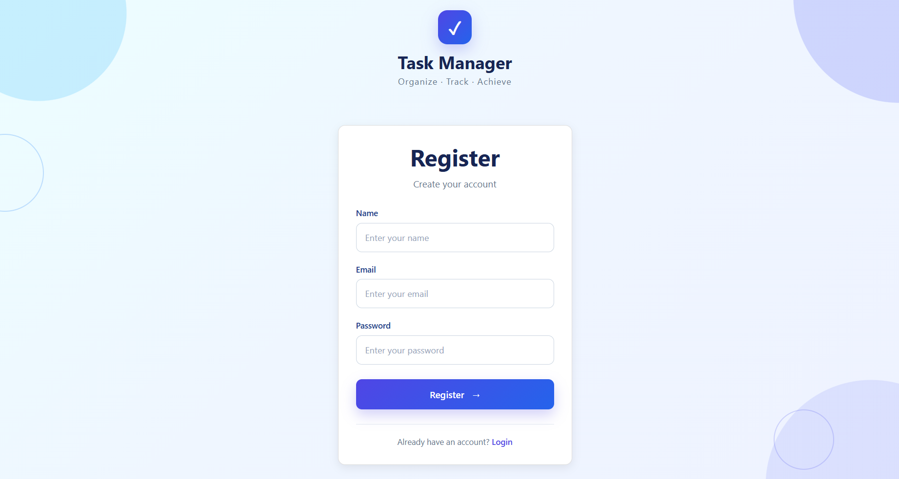
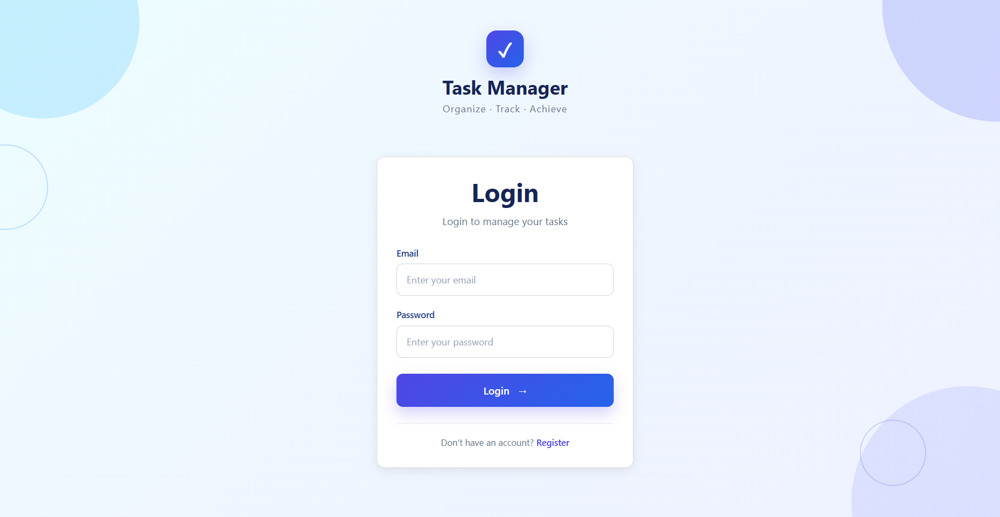
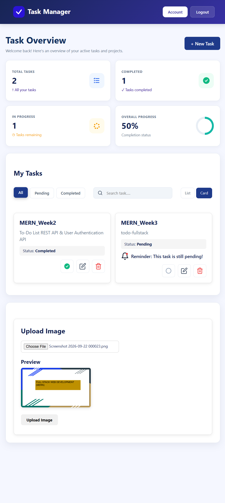
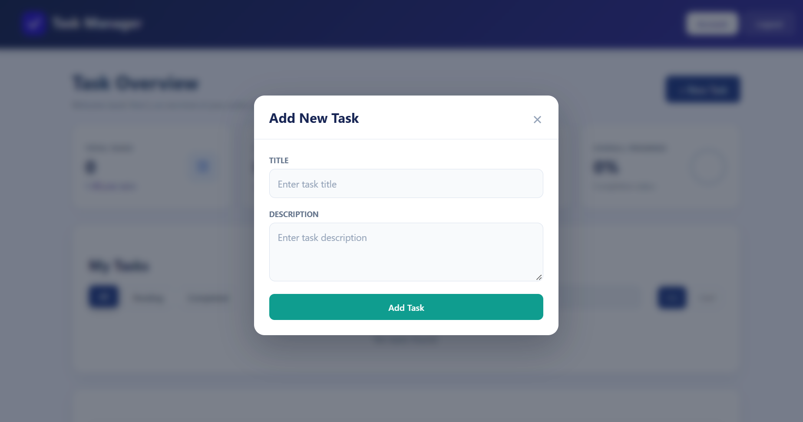

# Week 3 - Task Manager Application

A full-stack Task Manager web application developed as part of my MERN Stack internship Week 3 assignment.

The project connects a React frontend with Express.js, MongoDB, JWT authentication APIs, task management functionality, and a secure image upload feature.

---

## Project Overview

The Week 3 project focuses on building a complete task management application with:

- User Registration and Login
- JWT Authentication
- Task Creation, Viewing, Updating and Deletion
- Task Completion Tracking
- Task Filtering and Searching
- List and Card Views
- Task Statistics
- User Account Information
- Image Upload and Preview
- Uploaded Image Display and Deletion
- Responsive Dashboard UI

---

## Features

### 1. User Authentication

Users can:

- Register a new account
- Login with their account
- Access protected application features
- View their account information
- Logout securely

Authentication uses JSON Web Tokens (JWT).

---

### 2. Task Management

Users can manage their own tasks.

Available operations:

- Create a task
- View tasks
- Update tasks
- Delete tasks
- Mark tasks as completed
- View pending tasks

Each task can contain:

- Title
- Description
- Completion status
- Due date

---

### 3. Task Filtering

Tasks can be filtered by:

- All
- Pending
- Completed

---

### 4. Task Search

Users can search for tasks using the task title.

---

### 5. Task Views

The dashboard provides two task display modes:

- List View
- Card View

---

### 6. Task Statistics

The dashboard displays task analytics including:

- Total Tasks
- Completed Tasks
- Tasks In Progress
- Overall Progress

The dashboard also displays a circular progress indicator for overall task completion.

---

### 7. Account Panel

The account section provides:

- Account Details
- User Name
- User Email
- My Tasks
- Uploaded Images
- Logout

The account panel opens from the dashboard header.

---

### 8. Secure Image Upload

The project includes an image upload feature using Multer and JWT authentication.

Users can:

- Select an image
- Preview the selected image
- Upload the image
- View uploaded images
- Delete uploaded images

Image Security:

- Image APIs require a valid JWT token.
- Each user's images are stored in a separate folder using their user ID.
- Users can only view their own uploaded images.
- Users can only delete their own images.
- One user cannot access or delete another user's images.
- Supported formats: JPG, JPEG, PNG, GIF and WEBP.
- Maximum image size: 5 MB.

---

## Technologies Used

### Frontend

- React.js
- React Router
- Axios
- Vite
- HTML
- CSS
- JavaScript

### Backend

- Node.js
- Express.js
- MongoDB
- Mongoose
- JWT
- Multer
- CORS
- dotenv


### Development Tools

- Visual Studio Code
- MongoDB Atlas
- MongoDB Compass
- Postman
- Git
- GitHub

---

## Project Structure

```text
Week_3/
└── todo-fullstack/
    │
    ├── frontend/
    │   ├── src/
    │   │   ├── assets/
    │   │   ├── components/
    │   │   │   ├── TaskForm.jsx
    │   │   │   ├── TaskList.jsx
    │   │   │   └── ImageUpload.jsx
    │   │   │
    │   │   ├── pages/
    │   │   │   ├── Login.jsx
    │   │   │   ├── Register.jsx
    │   │   │   └── Dashboard.jsx
    │   │   │
    │   │   ├── services/
    │   │   │   └── api.js
    │   │   │
    │   │   ├── App.jsx
    │   │   └── App.css
    │   │
    │   ├── package.json
    │   └── vite.config.js
    │
    ├── backend/
    │   ├── uploads/
    │   │   └── <userId>/
    │   │       └── uploaded-images
    │   │
    │   ├── authMiddleware.js
    │   ├── server.js
    │   ├── package.json
    │   └── .env
    │
    └── README.md
```

**Note:**
- The `.env` file is created locally and is not committed to GitHub because it contains sensitive configuration values.
- The `uploads/` directory stores uploaded images in separate user-specific folders.
- Each user's images are stored using their unique user ID.
- Uploaded images and `.env` files should not be committed to the public repository.

---

## Local Development Folder Structure

The Week 2 APIs and Week 3 Task Manager project are maintained in separate folders on the local development machine.

```text
C:\Users\Falguni\
│
├── Week_2/
│   ├── User_Authentication_API/
│   └── todo-list-rest-api/
│
└── Week_3/
    └── todo-fullstack/
        ├── frontend/
        ├── backend/
        └── README.md
```

**Note:** This represents my local Windows development environment. Other users should replace the folder path with their own computer's path.

---

## API Services

### Task API

The task API runs on:
http://localhost:3000

Main task endpoint:
/api/tasks

The Task API supports task creation, retrieval, updating and deletion.

### Authentication API

The authentication API runs on: 
http://localhost:5000

Authentication endpoints include:
POST/api/auth/register
POST/api/auth/login
GET/api/auth/profile

The Authentication API handles user registration, login and JWT token generation.

### Image Upload API

The image upload backend runs on:
 http://localhost:4000

Image upload endpoint: 
POST /api/upload

Get uploaded images:
GET /api/upload

Delete an uploaded image:
DELETE /api/upload/:filename

Uploaded images are served from:
/uploads


All image API endpoints require JWT authentication through the Authorization header.
The frontend communicates with the backend services through the Vite development proxy.

---

## Installation

### Prerequisites

Install the following tools:

- Node.js and npm
- Git
- Visual Studio Code
- MongoDB Atlas account

---

### Clone the Repository

git clone https://github.com/FalguniRathod-07/Week3_MERN.git

Go to the project directory:
```bash
cd Week3_MERN/todo-fullstack
```

### Frontend Setup

Open a terminal and run:
```bash
cd frontend
```

Install dependencies:
```bash
npm install
```

Start the frontend:
```bash
npm run dev
```

The frontend will normally run at:
http://localhost:5173

If port 5173 is already in use, Vite may select another available port.

### Backend Setup

Open another terminal:
```bash
cd backend
```

Install dependencies:
```bash
npm install
```

Create a .env file inside the backend folder.

Add the following configuration:

  JWT_SECRET=your_authentication_api_jwt_secret

**Important:**

- Use the exact same JWT secret configured in the Week 2 Authentication API.
- Do not upload .env files or secret values to GitHub.
- Keep your JWT secret private.
- Never share your actual secret publicly

Start the image upload backend:
```bash
node server.js
```

The image upload backend runs on:
http://localhost:4000

### Authentication and Task APIs

The project also requires the Week 2 Authentication API repository.
Clone or place your Week 2 Authentication API separately on your computer

```bash
cd Week_2/User_Authentication_API
npm install
node server.js
```

The Authentication API Runs on:
http://localhost:5000

Make sure its .env file contains the required MongoDB connection URI, port and JWT secret.

### Task API

The project also requires the Week 2 To-do List REST API.
Open another terminal in your Week 2 Task API project folder:

```bash
cd Week_2/todo-list-rest-api
npm install
npm start
```

Runs on:
http://localhost:3000

Make sure its required environment variables are configured.

---

## MongoDB Atlas Setup

MongoDB Atlas is used as the cloud database.

- Create or use an existing MongoDB Atlas cluster.
- Configure the database connection URI in the appropriate API .env files.
- Add your current IP address to the Atlas Network Access IP Access List.
- Ensure the cluster is active.

MongoDB Atlas is cloud-hosted, so a local MongoDB server does not need to be started.

---

## Running the Complete Application

### Running the Complete Application

Start all four local services in separate terminal windows:

| Service | Command | Port |
|---|---|---|
| Authentication API | `node server.js` | 5000 |
| Task API | `node src/server.js` | 3000 |
| Image Upload Backend | `node server.js` | 4000 |
| React Frontend | `npm run dev` | 5173 or another available port |

**Important:**
- Keep all terminal windows running while using the application.
- Start the backend services before starting the frontend.
- Open the frontend URL shown by Vite in your browser.
- Register a new account or log in using your existing account to access the Task Manager application.

---

## Testing

The APIs were tested using:
Postman
MongoDB Compass
Browser

The frontend was tested using:
Chrome
Vite development server

---

## Screenshots

### Register Page


### Login Page


### Dashboard


### Add New Task


---

## Future Improvements

Possible future improvements include:

- Task due-date reminders
- Notifications
- Task priority
- Task categories
- Drag-and-drop task management
- Dark mode
- Cloud image storage
- Advanced dashboard analytics

---

## Author

Falguni Rathod
MERN Stack Internship - Week 3
